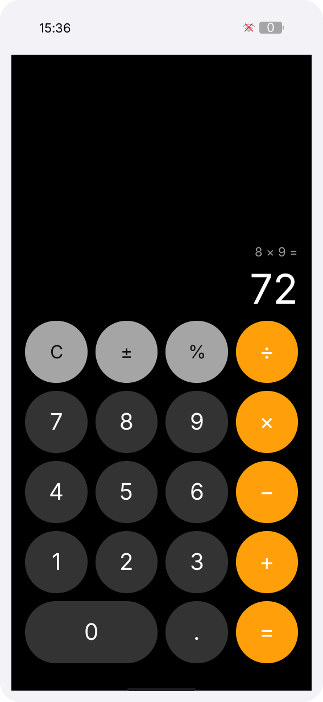

# LILYGO UI Calculator

**English** | [简体中文](README.zh-CN.md)

LILYGO UI Calculator is a touch-friendly scientific calculator for LILYGO UI,
built with C++17, [LILYGO UI AppKit](https://github.com/LILYGO-UI/cm0-appkit)
and LVGL 9.5. It provides an iPhone-inspired four-column keypad in portrait
orientation and expands to a scientific keypad in landscape orientation.

The project provides a CM0 ARM64 Linux device build and an SDL2 desktop
simulator for development and testing.

## Preview

<p>
  
</p>

## Features

- **Basic calculator:** arithmetic, parentheses, sign, percent, decimals, and scientific notation.
- **Expression display:** live expression preview with standard operator precedence.
- **Scientific functions:** powers, roots, trigonometric, inverse, hyperbolic, logarithmic, factorial, and absolute-value functions.
- **Constants and memory:** `e`, `pi`, random values, angle mode (`Rad`/`Deg`), and `mc`, `m+`, `m-`, `mr` operations.
- **Error handling:** automatic closing parentheses and visible `Error` results for division by zero, invalid domains, and overflow.
- **Responsive layout:** portrait `568x1232` and landscape `1232x568` layouts preserve expression, mode, and memory state across rotation.

The UI and state layer use LVGL. The calculation model is independent of LVGL
and can be tested in isolation.

## Development Environment

Project identity, version, and package metadata come from [`lpm.toml`](lpm.toml).
[`CMakePresets.json`](CMakePresets.json) defines the `host-simulator` and
`cm0-cross` configurations. Run commands from the repository root.

### Get the Source

```sh
git clone --recurse-submodules https://github.com/LILYGO-UI/lilygo-ui-calculator.git
cd lilygo-ui-calculator
git submodule update --init --recursive
```

AppKit is consumed directly from `third_party/cm0-appkit`; no separate AppKit
installation is required for the simulator. Its bundled LVGL archive is used
by default, with network fetching disabled in both presets.

### Host Dependencies

Use CMake 3.21 or later, Python 3.11 or later, a C++17 compiler, `pkg-config`,
`patch`, SDL2, and FreeType. Install LPM in a project-local virtual environment:

```sh
# Debian / Ubuntu
sudo apt update
sudo apt install build-essential cmake git pkg-config patch libsdl2-dev \
  libfreetype6-dev python3 python3-venv python3-pip

# macOS (with Xcode Command Line Tools and Homebrew)
xcode-select --install
brew install git cmake pkg-config patch sdl2 freetype python

python3 -m venv .venv
. .venv/bin/activate
python -m pip install "git+https://github.com/LILYGO-UI/lpm.git"
lpm --version
```

### Device Cross Compiler

Skip this step for the desktop simulator. Device builds need an AArch64 Linux
cross compiler:

```sh
# Debian / Ubuntu
sudo apt install gcc-aarch64-linux-gnu g++-aarch64-linux-gnu

# Apple Silicon macOS
brew install aarch64-unknown-linux-gnu
```

See [CM0BspBuilder](https://github.com/LILYGO-UI/CM0BspBuilder) for SDK
requirements. The BSP supplies target headers and libraries but does not install
the host cross compiler.

## Build and Test

Activate `.venv` before using LPM.

### Desktop Simulator

```sh
lpm start --foreground
```

Use `lpm start --no-build --foreground` to reuse an existing build. The Debug
build is stored in `build/host-simulator` and requires a graphical desktop
session.

### Tests

```sh
lpm test
```

| Test | Coverage |
| --- | --- |
| `calculator-core` | Expression parsing, evaluation, functions, errors, formatting, and memory workflow |
| `calculator-view-model` | Button commands and published UI state |
| `calculator-render-portrait` | Rendering and interactions at `568 x 1232` |
| `calculator-render-landscape` | Rendering and interactions at `1232 x 568` |

Render tests write `calculator-portrait.ppm` and `calculator-landscape.ppm` to
`build/host-simulator`. Inspect both after UI changes; passing assertions alone
does not verify visual layout. See the [UI development guidelines](docs/01-user-interface.md).

### CM0 Device Build

```sh
lpm pack
```

The `cm0-cross` preset targets CM0 Raspberry Pi OS on AArch64, uses a Release
build, and writes an ARM64 `.deb` package to `dist/`. The first build downloads
the pinned CM0 BSP and caches its sysroot under `.cache/cm0-bsp/`.

<details>
<summary>Underlying CMake commands</summary>

```sh
cmake --preset host-simulator
cmake --build --preset host-simulator --parallel
ctest --preset host-simulator

cmake --preset cm0-cross
cmake --build --preset cm0-cross --parallel
cpack --config build/cm0-cross/CPackConfig.cmake -B dist
```
</details>

## Documentation

| Guide | Contents |
| --- | --- |
| [Architecture overview](docs/00-overview.md) | Model, ViewModel, View boundaries and data flow |
| [UI development guidelines](docs/01-user-interface.md) | Layout, typography, colors, interaction states, and visual checks |

## Acknowledgments

The calculation feature set is inspired by [CardputerZero/Calculator](https://github.com/CardputerZero/Calculator).
The UI integration is implemented for LILYGO UI using [LILYGO UI AppKit](https://github.com/LILYGO-UI/cm0-appkit) and [LVGL](https://lvgl.io/).

## License

MIT
