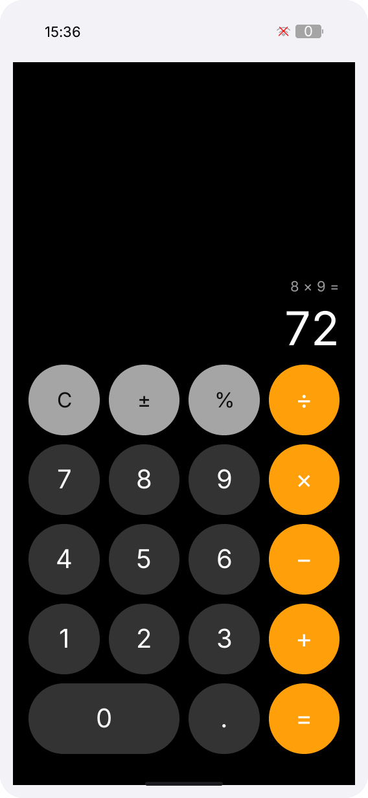

# LILYGO UI Calculator

[English](README.md) | **简体中文**

LILYGO UI Calculator 是面向 LILYGO UI 的触控科学计算器，基于 C++17、[LILYGO UI AppKit](https://github.com/LILYGO-UI/cm0-appkit) 和 LVGL 9.5 构建。竖屏提供接近 iPhone 计算器的四列基础键盘，横屏自动展开科学计算键区。

项目提供 CM0 ARM64 和 K230 Debian RISC-V 设备构建，以及用于开发和测试的 SDL2 桌面模拟器。

## 预览

<p></p>

## 功能

- **基础计算：** 四则运算、括号、正负号、百分比、小数和科学计数法。
- **表达式显示：** 实时表达式预览和标准运算符优先级。
- **科学函数：** 幂、根、三角、反三角、双曲、对数、阶乘和绝对值函数。
- **常量与内存：** `e`、`pi`、随机数、弧度/角度模式，以及 `mc`、`m+`、`m-`、`mr` 操作。
- **错误处理：** 自动补齐未闭合括号；除零、无效定义域和溢出显示 `Error`。
- **响应式布局：** 支持竖屏 `568x1232` 和横屏 `1232x568`，旋转时保留表达式、模式和内存状态。

界面和状态层使用 LVGL；计算 Model 不依赖 LVGL，可独立测试。

## 实体键盘

TCA8418 键盘和模拟器键盘支持输入数字、小数点、`+ - * /`、`%`、`^` 和括号。
按 `=` 计算结果，按 `C` 清空，按 Backspace 或 Delete 删除一位数字。
方向键可在控件之间移动焦点，Tab 将焦点移至下一个控件，Enter 激活当前聚焦的按键。
焦点指示框始终显示在按钮内部。

## 开发环境搭建

项目标识、版本和软件包元数据由 [`lpm.toml`](lpm.toml) 提供。[`CMakePresets.json`](CMakePresets.json) 定义 `host-simulator`、`cm0-cross` 和 `k230-debian` 配置。

### 获取源码

```sh
git clone --recurse-submodules https://github.com/LILYGO-UI/lilygo-ui-calculator.git
cd lilygo-ui-calculator
git submodule update --init --recursive
```

### 主机依赖与 LPM

需要 CMake 3.21+、Python 3.11+、C++17 编译器、`pkg-config`、`patch`、SDL2 和 FreeType。安装 LPM：

```sh
sudo apt install build-essential cmake git pkg-config patch libsdl2-dev libfreetype6-dev python3 python3-venv python3-pip
python3 -m venv .venv
. .venv/bin/activate
python -m pip install "git+https://github.com/LILYGO-UI/lpm.git"
```

设备构建还需要 AArch64 交叉编译器：`sudo apt install gcc-aarch64-linux-gnu g++-aarch64-linux-gnu`。SDK 要求详见 [CM0BspBuilder](https://github.com/LILYGO-UI/CM0BspBuilder)。

## 构建与测试

```sh
lpm start --foreground
lpm test
lpm pack
```

`lpm start` 启动 SDL2 模拟器，`lpm test` 运行核心、ViewModel 以及横竖屏渲染测试，`lpm pack` 生成输出到 `dist/` 的 ARM64 `.deb`。渲染结果位于 `build/host-simulator`，修改 UI 后请检查生成的 PPM 图片。

### 使用 LPM 构建 K230 Debian riscv64

需要包含 K230 和 macOS LLVM 支持的 AppKit 源码 SDK。当前工作区可共用
`../cm0-appkit`，准备一次 sysroot，再为本应用选择 SDK：

```sh
brew install llvm lld dpkg
python3 ../cm0-appkit/tools/prepare-riscv64-sysroot.py
cmake --preset k230-debian -DLilyGoUI_DIR="$PWD/../cm0-appkit"
lpm pack --arch riscv64
```

输出为 `dist/<package>_<version>_riscv64.deb`。配置会记住 SDK 路径，后续运行
`lpm pack --arch riscv64` 即可。支持保存目标的 LPM 版本也可先运行
`lpm set-target k230`，之后只运行 `lpm pack`。
`lpm pack --arch arm64` 构建原有 CM0 目标；两套 sysroot 都准备好后可运行
`lpm pack --all-architectures`。

独立检出时，请将 `third_party/cm0-appkit` 固定到包含这些功能的兼容发布版本，
并在准备和配置命令中使用该目录。首次配置默认使用子模块，也可通过
`LILYGO_UI_APPKIT_DIR` 环境变量指定 SDK。Linux 使用 `riscv64-linux-gnu-gcc/g++`
交叉编译器和同一准备脚本。默认 sysroot 在所选 SDK 的
`.cache/k230-debian/sysroot`，可用
`-DLILYGO_UI_DEBIAN_SYSROOT=/path/to/sysroot` 覆盖。该 Debian 目标不能使用 Buildroot sysroot。


## 文档

| 指南 | 内容 |
| --- | --- |
| [架构概览](docs/00-overview.md) | Model、ViewModel、View 边界和数据流 |
| [UI 开发规范](docs/01-user-interface.md) | 布局、字体、颜色、交互状态和视觉检查 |

## 致谢

计算功能参考 [CardputerZero/Calculator](https://github.com/CardputerZero/Calculator)，UI 集成基于 [LILYGO UI AppKit](https://github.com/LILYGO-UI/cm0-appkit) 和 [LVGL](https://lvgl.io/) 重新实现。

## License

MIT
